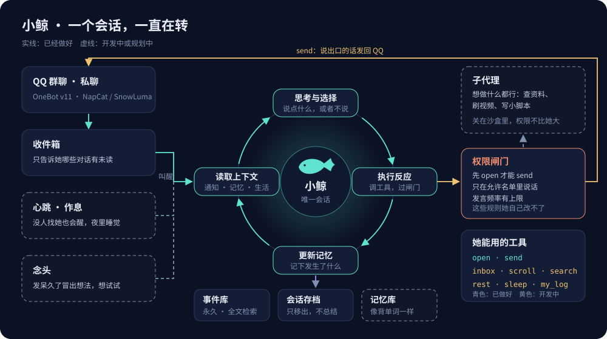
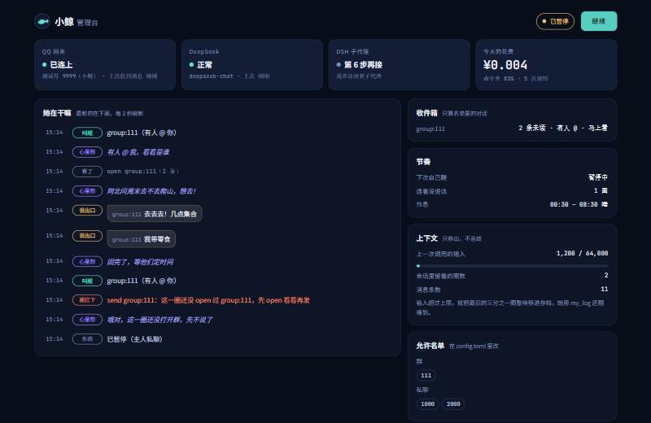

# 小鲸

一个住在 QQ 里、一直在想事情的陪伴。

> 本项目由 AI 辅助完成：设计和代码都是在 Claude Opus 5.5 的协助下写的。

小鲸不是问一句答一句的机器人。她只有一个人格、一个会话，所有群聊和私聊都在同一条思路里处理。有人找她时她被叫醒，自己去看是谁、说了什么，再决定要不要开口；没人找她时，她也会按心跳自己醒来看看。她心里想的和说出口的分开：心里想的只留在她自己的会话里，只有她决定 `send` 的话才会发到 QQ。



## 设计思路

**一个人格，一个会话。** 不给每个群开一个分身。她在 A 群聊过的事，在私聊里也记得；没想完的事，在同一条上下文里接着想。

**自己看通知。** 叫醒她的消息只说"哪些对话有几条未读"，不直接塞内容。看哪个、看多少、回不回，都是她自己用工具决定的。群里大家聊得好好的，她看看就走也行。实际跑起来，她会在心里说"这波我插不上嘴，看着就行"，然后自己定半小时后再醒。

**一圈四步。** 每次醒来转一圈：读取上下文 → 思考与选择 → 执行反应 → 更新记忆。"什么都不做"也是一种选择。

**有节奏地醒着。** 私聊和被 @ 马上醒；群里没 @ 她的消息先攒一会儿，一次看完；没人找她就按她自己定的间隔醒；夜里睡觉，只有主人私聊能叫醒她，其他消息攒到早上。

**只移出，不总结。** 上下文满了，最早的一段整块移进存档，不压缩、不总结。原文一直在，她用 `my_log` 按日期就能翻回来。一次移一大块，是为了让提示词前缀尽量不变，多命中缓存、少花钱。

**权限不交出。** 她每次想发消息都要过闸门：这一圈里先打开过那个对话才能发、只能在允许名单里说话、发言频率有上限、一条有长度上限。消息按纯文本段发出，她写的 `[CQ:...]` 不会被当成 QQ 指令。闸门规则、人设、工具表都在她够不着的地方，密钥也不进她的上下文。

**模型只是载体。** 现在用 DeepSeek，换别的 OpenAI 兼容接口改一行配置就行。人格在 `persona.md`，运转规矩在 `prompts/system.md`，都是纯文本。

## 想做成什么样

下面这些还在规划，进度见下一节。

- **好奇心**：连着发呆几圈，冒出念头的概率会越来越高，她会突发奇想："如果做了会怎么样？" 做之前先写下预期，结果回来时和预期对比，差得越多越惊讶，惊讶的事记得越牢。聊天里也一样：旁听几圈没开口，也会想插一句。
- **记忆像背单词**：记忆分层，平时只看标题，读一次全文就回到最上层。用 ACT-R 的激活公式算每条记忆该在哪一层：读得越多、越近，越不容易忘；太久没碰的会慢慢沉下去，最后被忘掉。标了重要的不会被忘。
- **说话不像人机**：准备一套分场景的语气参考（日常聊天、解决问题、接住情绪、分享发现、轻松回应），用 RBT3 小模型判断场景，每圈挑几段放进提示里。
- **想做什么都行**：通过子代理去查资料、刷视频、写小脚本，关在沙盒里，权限不比她大。

## 现在做到哪

| 步骤 | 内容 | 状态 |
|---|---|---|
| 1 | 骨架：连 QQ、事件库、唯一会话、闸门、花费记录、管理台 | ✅ 已完成，测试号上实测通过 |
| 2 | 收件箱、心跳、作息、按真实 token 移出上下文、翻旧账工具 | ✅ 已完成，测试号上实测通过 |
| 3 | 记忆：分层记忆库、ACT-R 公式、睡前整理 | ⏳ |
| 4 | 好奇：念头生成、思绪板、预期和结果对比 | ⏳ |
| 5 | 语气：语料库、RBT3 场景分类、人机味打分 | ⏳ |
| 6 | 行动：子代理、信息源 | ⏳ |
| 7 | 影子模式试跑，然后上线 | ⏳ |

她现在能用的工具：

| 工具 | 做什么 |
|---|---|
| `inbox` | 看收件箱：哪些对话有未读、几条、有没有人 @ 她 |
| `open` | 打开一个对话看最近的消息。往一个对话发消息前，这一圈里必须先打开它 |
| `scroll` | 在对话里往上翻更早的消息 |
| `search` | 在聊天记录里搜关键词 |
| `send` | 发一条 QQ 消息 |
| `my_log` | 翻自己某一天想过什么、做过什么，包括已经移出上下文的部分 |
| `rest` | 这一圈到此为止，自己定几分钟后再醒 |
| `sleep` | 去睡觉，到早上再醒 |

## 管理台

一直在转的东西，得有个地方一眼看到她在干嘛、一键让她停下。管理台只在本机打开，要口令。



- **顶上**：QQ 网关、DeepSeek、子代理的状态灯，今天花了多少钱、缓存命中率；右上角是状态和暂停按钮
- **左边**：她这一圈在干嘛，像聊天记录一样往下滚：被叫醒、心里想、看了哪个对话、说出口了什么、被闸门拦下了什么
- **右边**：收件箱（每个对话几条未读、马上看还是在攒着）、节奏（下次几点醒、连着几圈没说话、作息）、上下文用量、允许名单

截图里是演示数据，用的是假 QQ 和假模型。

## 跑起来

### 需要什么

- Python 3.11 以上。**只用标准库，不用装任何包。**
- 一个 OneBot v11 实现，比如 [NapCat](https://github.com/NapNeko/NapCatQQ) 或 SnowLuma，登录一个 QQ 号。建议用小号，见文末"注意"。
- 一个 DeepSeek（或其他 OpenAI 兼容接口）的 API key。

### 1. 配 OneBot

在 NapCat / SnowLuma 的网页后台，给登录的号打开两样：

| 项 | 填什么 |
|---|---|
| HTTP 服务器 | `127.0.0.1`，端口 `3020`，设一个 token；消息格式 `array` |
| HTTP 客户端（上报 / webhook） | 地址 `http://127.0.0.1:5311/`，设一个 token 作为签名密钥；消息格式 `array` |

不用开 WebSocket。端口别用 4300–4310，QQ 自己会占这一段。

### 2. 改配置

把 `config.example.toml` 复制一份改名成 `config.toml`，至少填：

- `gate.owner_qq`：你自己的 QQ 号。私聊她发「暂停」「继续」只认这个号，夜里也只有这个号能叫醒她
- `gate.allow_groups`：允许她说话的群
- `gate.allow_users`：允许私聊她的号
- `llm.model`、价格：按你用的模型改

其他可以先不动：

- `[inbox]`：群里没 @ 她的消息攒多少秒再叫醒（默认 30 秒），同一个群最快多久看一次（默认 3 分钟）
- `[rhythm]`：默认心跳间隔、她能选的最短和最长间隔、几点睡几点醒（默认 00:30–08:30）
- `context_budget`：上下文超过多少 token 开始移出（默认 64000）

### 3. 设置密钥

密钥只放环境变量，不写进任何文件：

| 变量名 | 填什么 |
|---|---|
| `DEEPSEEK_API_KEY` | 模型的 API key |
| `ONEBOT_TOKEN` | HTTP 服务器的 token |
| `ONEBOT_SECRET` | HTTP 客户端的 token（签名密钥） |

Windows 上建议在"编辑账户的环境变量"里设，别在终端里敲 `setx`，终端会把密钥记进命令历史。设完要重新开一个终端。

### 4. 启动

```
python -m xiaojing
```

打开 http://127.0.0.1:5310/ ，口令在 `data/console-token.txt`。去允许的群里 @ 她，或者私聊她试试。

急停：管理台的「暂停」按钮，或者用 `owner_qq` 那个号私聊她发「暂停」，发「继续」恢复。

只想看看管理台长什么样、不连 QQ：

```
python -m tests.demo_console
```

打开 http://127.0.0.1:5319/ ，口令 `demo`。

### 跑测试

```
python -m unittest discover -s tests -t .
```

全部用假 QQ 和假模型，不连真 QQ，不花钱。

## 代码在哪

| 文件 | 管什么 |
|---|---|
| `xiaojing/agent.py` | 唯一会话：一圈怎么转、叫醒规则、工具、上下文移出 |
| `xiaojing/rhythm.py` | 作息：几点睡、几点醒 |
| `xiaojing/gate.py` | 权限闸门 |
| `xiaojing/onebot.py` | 连 QQ：调动作、解析上报、验签 |
| `xiaojing/store.py` | 事件库（SQLite + 全文检索）、收件箱、花费、管理台动态 |
| `xiaojing/console.py`、`console.html` | 管理台 |
| `xiaojing/httpserver.py` | 一个很小的异步 HTTP 服务器 |
| `prompts/system.md` | 运转规矩：她是怎么被叫醒、怎么转一圈的 |
| `persona.md` | 人设：她是谁、怎么说话 |
| `corpus/` | 分场景的语气参考模板 |

## 花费

按 DeepSeek-V4.1-Flash 闲时价估算：上下文 6 万 token 命中缓存时，空转一圈约 ¥0.003，高峰时段翻倍。她调了 `rest` 这一圈就直接结束，所以只是醒来看一眼、什么都不做，只花一次调用的钱。群越活跃花得越多，`[inbox]` 里的 `group_min_interval` 就是控制这部分花费的开关。管理台会实时记账。

提示词开头的固定部分（规矩和人设）不要常改，改一次缓存就要重新攒。

## 注意

- **用小号。** 通过第三方客户端让 QQ 号自动收发消息，可能违反腾讯的用户协议，账号有被限制或封禁的风险。请自己评估。
- **SnowLuma 的用户协议禁止用脚本部署它**，所以这个项目只探测它在不在线，不会去启动它。用别的 OneBot 实现也请先看各自的条款。
- 所有消息会永久存在本地的 `data/events.db` 里，包括没在允许名单里的群。`data/` 已经写进 `.gitignore`，不要把它传到网上。

## 许可证

[MIT](LICENSE)
